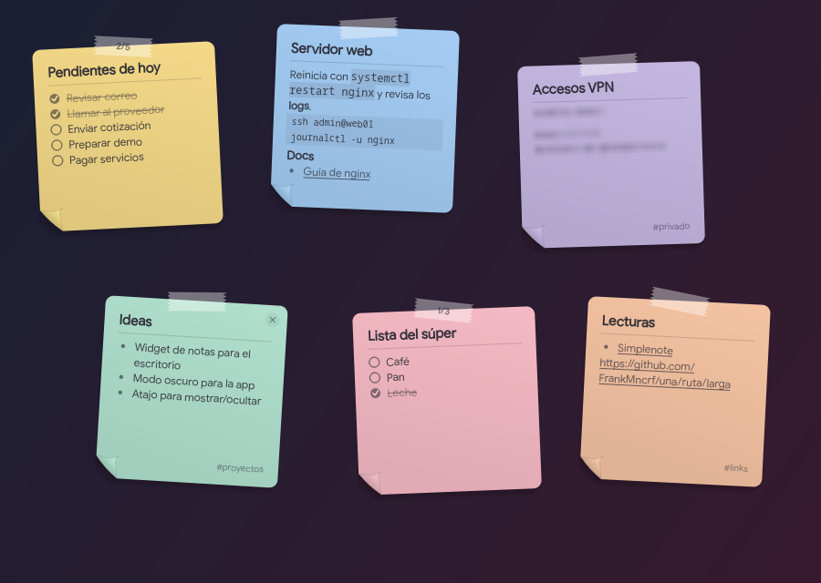

# SimplePost-It

**Tus notas fijadas de [Simplenote](https://simplenote.com) como post-its en el escritorio.** Linux, Windows y macOS.

SimplePost-It es una capa sobre Simplenote. Las notas que fijas en Simplenote (*Pin to top*) aparecen en el escritorio como post-its que puedes acomodar, leer, marcar y editar sin abrir la app. Todo lo que cambias en el widget se guarda en tu cuenta de Simplenote y llega a tus otros dispositivos.

*English: SimplePost-It is a desktop layer for Simplenote on Linux, Windows and macOS. It shows your pinned Simplenote notes as sticky notes on the desktop; changes sync back to your Simplenote account. It needs the Simplenote desktop app, installed and signed in. The interface is available in Spanish and English.*



> SimplePost-It es un proyecto independiente: no está afiliado a Simplenote ni a Automattic, y no modifica Simplenote.

## Qué hace

- **Notas fijadas en el escritorio:** cada nota es un post-it con cinta adhesiva, esquina doblada e inclinación propia. El texto largo se desplaza con la rueda del ratón.
- **Acomódalas:**
  - Arrástralas dentro del tablero; un clic trae una nota al frente.
  - **Ctrl+rueda** cambia su inclinación.
  - El botón **▦** las ordena en cuadrícula.
  - Las notas que fijas después buscan solas un hueco libre.
- **Tareas:** las listas `- [ ]` de Simplenote se marcan con un clic, y la cinta muestra el avance (`2/5`).
- **Editar sin abrir Simplenote:** doble clic en el cuerpo de la nota abre un mini editor. Desde ahí, o con clic derecho sobre la nota, también se manda a la papelera de Simplenote (la × solo la quita del escritorio).
- **Simplenote siempre a mano:** doble clic en el título muestra Simplenote. SimplePost-It puede mantener Simplenote abierto en segundo plano con la ventana oculta, y mostrarla u ocultarla desde su ícono en la bandeja.
- **Nueva nota:** el botón **+** crea una nota ya fijada, con o sin Markdown.
- **Quitar del escritorio:** la **×** solo desfija la nota; la nota sigue en tu cuenta.
- **Markdown:** en las notas con Markdown activado en Simplenote se ven:
  - **negritas**, *cursivas* y `código`
  - bloques de código y subtítulos
  - enlaces con nombre
- **Enlaces:** Ctrl+clic abre el enlace en el navegador.
- **Etiquetas** al pie de cada nota.
- **Clic derecho en una nota:**
  - **Color**.
  - **Minimizar:** solo se ve el título.
  - **Privada:** la nota lleva la etiqueta `privado` en Simplenote y su texto se ve borroso hasta pasar el ratón por encima.
- **Mostrar/ocultar todas las notas** con un atajo de teclado (Super+N en Linux, Ctrl+Alt+N en Windows).
- **Ajustes:**
  - Inicio con la sesión, idioma y atajo.
  - Número máximo de notas, opacidad, tamaño, inclinación y fuente.
  - Tamaño, monitor y posición del tablero: elige la esquina de referencia, o arrastra el tablero entero mientras Ajustes está abierto. Si conectas o quitas un monitor, el tablero se recoloca solo.
  - Cuenta.
  - Acerca de y donaciones.

## Requisitos

- **La app de escritorio de Simplenote**, instalada y con la sesión iniciada. Descárgala de [simplenote.com](https://simplenote.com), o en Linux desde tu distribución, Flatpak o Snap.
  - En macOS, la versión de la Mac App Store guarda su sesión de forma protegida. Con esa versión, inicia sesión una vez en SimplePost-It: **Ajustes → Cuenta**.
- **Linux:** Python 3.10+ y PyQt6, con un escritorio X11 o XWayland y compositor (para la transparencia). Se probó en XFCE.
- **Windows 10/11** y **macOS 12+:** no necesitan nada más, porque el instalador incluye todo.

## Instalación

Copia el comando de tu sistema. Descarga la última versión y la instala. Para actualizar, vuelve a ejecutarlo.

**Linux** (Arch/CachyOS/Manjaro, Debian/Ubuntu/Mint, Fedora, openSUSE), en una terminal:

```bash
curl -fsSL https://raw.githubusercontent.com/FrankMncrf/SimplePost-It/main/packaging/linux/install.sh | bash
```

Instala el paquete de tu distribución y pide tu contraseña para eso. En otras distribuciones, o si antepones `SIMPLEPOSTIT_USER=1` a `bash`, lo instala desde el código solo para tu usuario, en `~/.local`.

**macOS** (Apple Silicon o Intel), en Terminal:

```bash
curl -fsSL https://raw.githubusercontent.com/FrankMncrf/SimplePost-It/main/packaging/macos/install.sh | bash
```

**Windows 10/11**, en PowerShell:

```powershell
irm https://raw.githubusercontent.com/FrankMncrf/SimplePost-It/main/packaging/windows/install.ps1 | iex
```

En macOS y Windows se instala solo para tu usuario y sin contraseña de administrador. Los archivos no llevan firma de pago de Apple ni de Microsoft. Por eso, si los descargas con el navegador, el sistema los frena; con estos comandos no.

### Descarga manual

Desde [Releases](https://github.com/FrankMncrf/SimplePost-It/releases):

| Sistema | Archivo |
|---|---|
| Windows | `SimplePost-It-…-windows-setup.exe`, o la versión portable `.zip` |
| macOS | `SimplePost-It-…-macos-arm64.dmg` (Apple Silicon) o `…-macos-x86_64.dmg` (Intel): arrastra la app a Aplicaciones |
| Debian / Ubuntu | `simplepostit_…_all.deb` |
| Fedora / openSUSE | `simplepostit-….noarch.rpm` |
| Arch / CachyOS / Manjaro | `simplepostit-….pkg.tar.zst`, o `PKGBUILD` |

En Linux también puedes instalarlo desde el código, solo para tu usuario:

```bash
git clone https://github.com/FrankMncrf/SimplePost-It.git
cd SimplePost-It
./install.sh              # ./install.sh --uninstall para quitarlo
```

Si descargaste a mano:

- **macOS** dirá que la app no está firmada. Ábrela una vez y luego ve a **Ajustes del Sistema → Privacidad y seguridad → Abrir igualmente**. O ejecuta `xattr -dr com.apple.quarantine /Applications/SimplePost-It.app`.
- **Windows:** si SmartScreen avisa, elige **Más información → Ejecutar de todas formas**. Si **Control inteligente de aplicaciones** de Windows 11 está activado, bloquea cualquier programa sin firma y no deja ejecutarlo; usa el comando de PowerShell de arriba. Si aun así lo bloquea, por ahora no hay otra salida que esperar la versión firmada.

La primera vez se abren los Ajustes y SimplePost-It se agrega al inicio de sesión (se puede desactivar). Para cambiar algo después, haz clic derecho en el ícono de la bandeja → **Ajustes…**.

## Cómo funciona

SimplePost-It **no modifica Simplenote**.

- **Sesión:** lee, sin cambiar nada, la sesión que la app de escritorio de Simplenote guarda en tu perfil. Así no te pide la contraseña. Si no puede leerla, puedes iniciar sesión en **Ajustes → Cuenta**; ahí solo se guarda la sesión, nunca la contraseña.
- **Sincronización:** con esa sesión habla directamente con [Simperium](https://simperium.com), el servicio de sincronización de Simplenote. Lee las notas fijadas cada pocos segundos y envía los cambios que hagas en el widget. Tus notas no pasan por ningún otro servidor.
- **Ventana de Simplenote:** para mantenerla oculta, SimplePost-It la controla desde fuera como cualquier gestor de ventanas: X11 en Linux, Win32 en Windows, AppKit en macOS.
- **Datos locales:** solo guarda tus ajustes y la posición, inclinación, color y estado minimizado de cada nota.

| | Ajustes | Posición de las notas |
|---|---|---|
| Linux | `~/.config/simplepostit/` | `~/.local/state/simplepostit/` |
| Windows | `%APPDATA%\SimplePost-It\` | igual |
| macOS | `~/Library/Application Support/SimplePost-It/` | igual |

### Limitaciones conocidas

- La API de Simperium no es una interfaz oficial documentada por Simplenote. Si cambia, SimplePost-It podría dejar de funcionar hasta adaptarlo.
- El doble clic en el título muestra Simplenote, pero no puede abrir esa nota concreta: Simplenote no ofrece esa función a otras apps.
- Si cierras Simplenote con su botón **×**, se cierra de verdad. SimplePost-It la vuelve a abrir cuando la pidas.
- **macOS:**
  - El ícono de Simplenote en el Dock no se puede quitar sin modificar la app.
  - Tampoco hay atajo global; usa el ícono de la barra de menús.
- **Linux con Wayland:** se usa XWayland, porque en Wayland una ventana no puede elegir su posición ni quedarse bajo las demás. El atajo global se configura solo en XFCE; en otros escritorios, crea un atajo que ejecute `simplepostit --toggle`.

## Uso desde la terminal

```bash
simplepostit              # iniciar (o mostrar las notas si ya está en marcha)
simplepostit --toggle     # mostrar u ocultar las notas
simplepostit --settings   # abrir los ajustes
simplepostit --quit       # cerrar
SIMPLEPOSTIT_FILE=demo.txt simplepostit   # modo demo con notas de un archivo, sin cuenta
```

## Desarrollo

- **Pruebas:** `make test` (necesita PyQt6; no usa red ni tu cuenta).
- **Traducciones:**
  - El español es el idioma de origen.
  - Los textos en inglés están en [`i18n/en.json`](i18n/en.json).
  - Para agregar un idioma, copia ese archivo como `i18n/<código>.json` y tradúcelo.
- **Paquetes:**
  - [`packaging/`](packaging): Arch, Debian, RPM, PyInstaller e Inno Setup.
  - [GitHub Actions](.github/workflows/build.yml) compila Windows, macOS, `.deb` y `.rpm` en cada versión.

¿Ideas o errores? Abre un [issue](https://github.com/FrankMncrf/SimplePost-It/issues).

## Apoyar el proyecto

SimplePost-It es gratuito y libre. Si te resulta útil, puedes apoyarlo:

- ☕ [Buy Me a Coffee](https://buymeacoffee.com/frankmncrf)
- ₿ Bitcoin: `bc1qm45kpx35uazdts3q8vc77edqwyajuxe9cexw0er5409dyevl3nysxhln9g`
- ★ Dale una estrella al repositorio.

## Licencia

[GPL-3.0-or-later](LICENSE) © 2026 FrankMncrf. Simplenote es una marca de Automattic.
